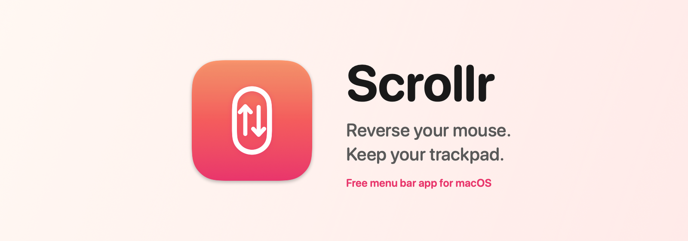
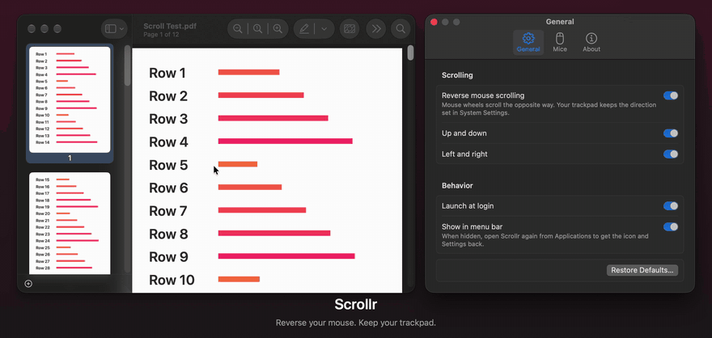
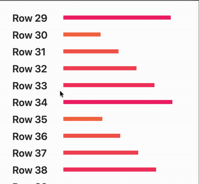
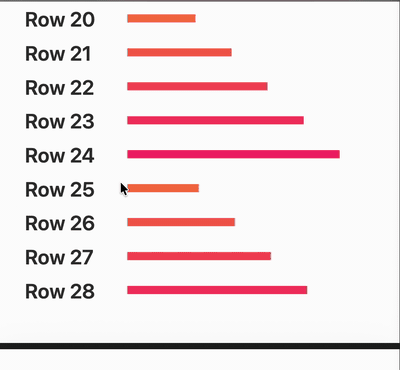
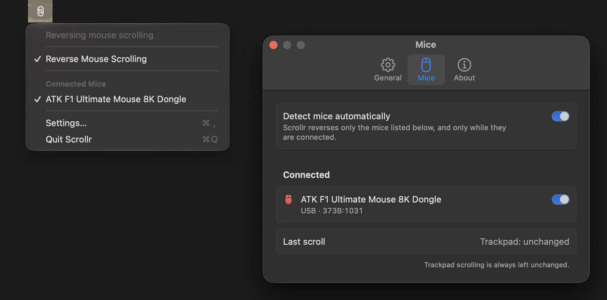
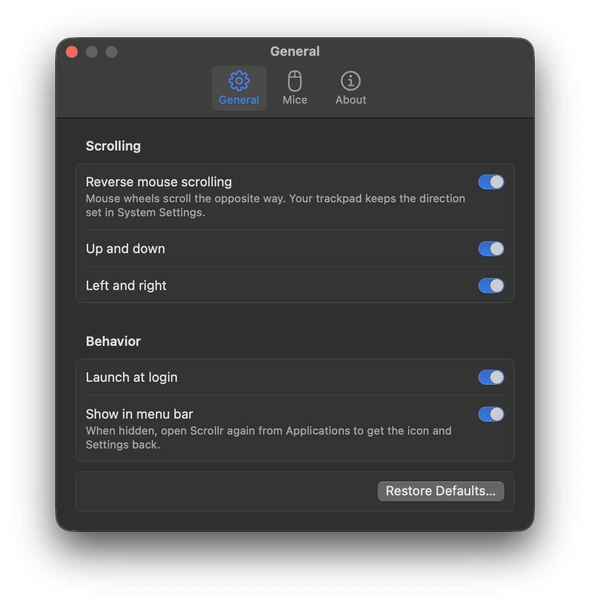
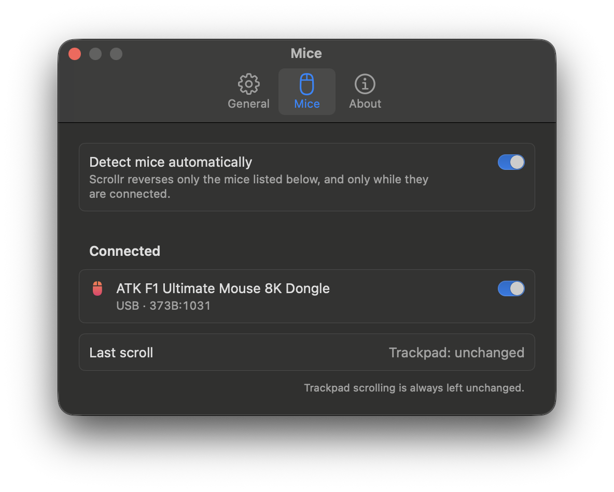
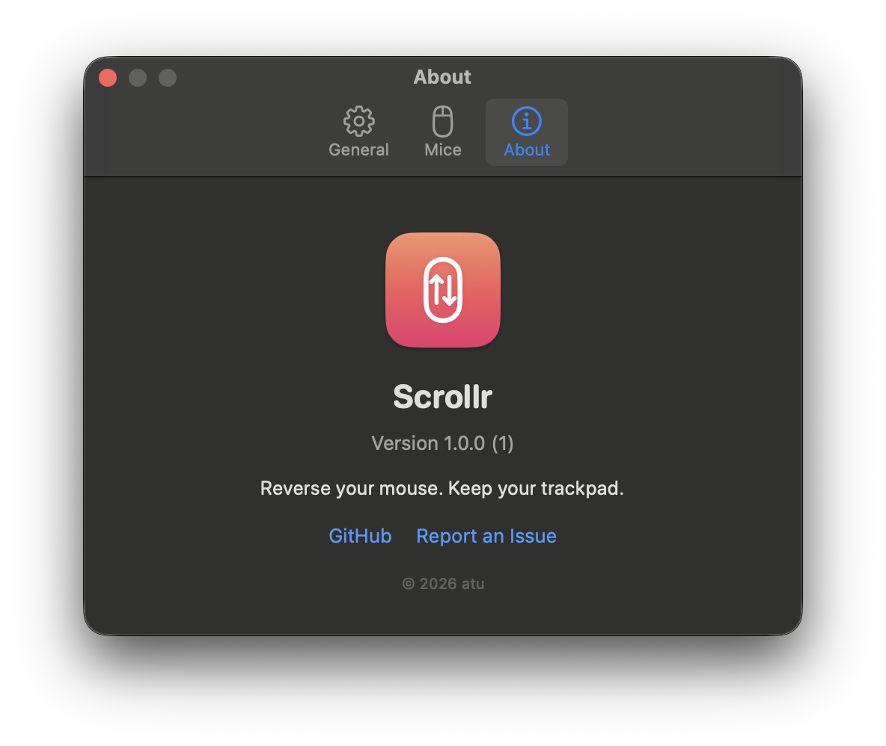

<div align="center">



[](#requirements)
[](#build-from-source)
[](#requirements)
[](LICENSE)

**[Download](https://github.com/atuuuuuuu/Scrollr/releases/latest)** · [How it works](#how-it-works) · [Install](#install) · [Settings](#settings) · [Troubleshooting](#troubleshooting) · [Build](#build-from-source)

</div>

macOS has one **Natural scrolling** switch for every device. Turn it on and your trackpad feels right but your mouse
wheel scrolls backwards. Turn it off and it's the other way round. **Scrollr** fixes that from the menu bar: it flips
the scroll direction of external mice only, so the wheel goes the way you expect while the trackpad keeps exactly the
setting you chose in System Settings. It notices when a mouse is plugged in or unplugged, can be switched off for
one mouse but not another, and uses no measurable CPU while you work.

<div align="center">
  
  <br><sub>Recorded on macOS 27 with the Scrollr 1.0.0 release build.
  The scroll input was sent by a script (mouse-style and trackpad-style events) so each take is identical.
  <a href="assets/demo.mp4">Watch the MP4</a></sub>
</div>

## How it works

<table>
  <tr>
    <th width="50%">Mouse wheel, Scrollr on</th>
    <th width="50%">Trackpad, Scrollr on</th>
  </tr>
  <tr>
    <td></td>
    <td></td>
  </tr>
  <tr>
    <td align="center"><sub>Same input as the trackpad on the right: the page goes the <b>other way</b>.</sub></td>
    <td align="center"><sub>Passed through untouched: the page goes the way macOS says.</sub></td>
  </tr>
</table>

Trackpads (and the Magic Mouse) report every scroll in phases: fingers down, moving, lifted, then momentum.
A mouse wheel sends plain clicks with no phase. Scrollr watches scroll events with a system event tap and flips only
the phase-less ones, so trackpad scrolling can't be touched by accident. It never changes the global Natural
scrolling setting.

To know *which* mouse is scrolling, Scrollr lists pointing devices through IOKit and watches only their wheel
controls, never pointer movement. That keeps it idle even with an 8000 Hz gaming mouse.

## Features

- **Mouse only.** External mice are reversed; the built-in trackpad and Magic Trackpads keep the system setting.
- **Automatic detection.** Mice show up the moment they connect (USB or Bluetooth) and disappear when unplugged.
  Scrollr re-arms itself after the Mac wakes from sleep.
- **Per-mouse switch.** Keep reversing your desk mouse but not the travel one. The setting sticks to the mouse model.
- **Pick the axes.** Reverse up and down, left and right, or both.
- **Menu bar status.** The icon dims when nothing is being reversed; the menu shows what Scrollr is doing and which
  mice are connected.
- **Launch at login** and an optional hidden menu bar icon.
- **Lightweight.** Under 40 MB of memory, no background polling, no network access at all.

## Install

1. Download **`Scrollr-macOS.zip`** from the [latest release](https://github.com/atuuuuuuu/Scrollr/releases/latest)
   and unzip it.
2. Move **Scrollr** to your **Applications** folder and open it.
3. Scrollr isn't notarized by Apple (that needs a paid developer account), so macOS stops it the first time.
   Open **System Settings → Privacy & Security**, scroll down and click **Open Anyway** next to the Scrollr message,
   then confirm. You only do this once.
   <details><summary>Prefer Terminal?</summary>

   ```bash
   xattr -dr com.apple.quarantine /Applications/Scrollr.app
   ```
   </details>
4. Allow Scrollr to control scrolling when asked (see [Permission](#permission)). Scrolling flips within two
   seconds; no restart needed.

## Usage

Click the Scrollr icon in the menu bar:

<div align="center">
  
  <br><sub>Screenshot of Scrollr 1.0.0 on macOS 27.</sub>
</div>

- **Reverse Mouse Scrolling** switches everything on or off.
- **Connected Mice** lists every detected mouse; untick one to leave it alone.
- **Settings…** (⌘,) opens the window below.

## Settings

<table>
  <tr>
    <td width="33%"></td>
    <td width="33%"></td>
    <td width="33%"></td>
  </tr>
  <tr>
    <td align="center"><b>General</b></td>
    <td align="center"><b>Mice</b></td>
    <td align="center"><b>About</b></td>
  </tr>
</table>

| Setting | What it does |
|---|---|
| Reverse mouse scrolling | The master switch. |
| Up and down / Left and right | Which directions are flipped. |
| Launch at login | Starts Scrollr when you log in (it appears under *Login Items & Extensions*). |
| Show in menu bar | Hides the icon. Open Scrollr again from Applications to bring it and Settings back. |
| Restore Defaults… | Everything on, detection on, all mice reversed, Launch at login off. |
| Detect mice automatically | On: only the listed mice are reversed, and only while connected. Off: every scroll wheel is reversed, even mice Scrollr can't identify. |
| Per-mouse switches | Turn reversal off for one mouse model. |
| Last scroll | Live check of what your last scroll came from and whether Scrollr flipped it. |

## Permission

Changing scroll events requires macOS's **Accessibility** permission. On macOS 27 the list is called
**Device Control and Data Access**; it lives in **System Settings → Privacy & Security** either way.

- Scrollr asks on first launch, and the menu and Settings show a button to open the right page while it is missing.
- It only reads and changes **scroll** events. It never sees key presses, never records anything and has no network
  code.

## Requirements

- macOS 14 Sonoma or later (developed and tested on macOS 27.2).
- Apple silicon or Intel: the release is a universal app.
- Any USB or Bluetooth mouse with a scroll wheel.

## Troubleshooting

<details>
<summary><b>My mouse still scrolls the old way</b></summary>

1. Open **Settings → Mice** and scroll with the mouse. *Last scroll* should name your mouse and say *reversed*.
2. If it says *unchanged*, check that **Reverse mouse scrolling** is on and the switch next to your mouse is on.
3. If your mouse isn't listed, turn off **Detect mice automatically**: Scrollr then reverses every scroll wheel.
</details>

<details>
<summary><b>Nothing happens at all</b></summary>

Scrollr probably doesn't have permission yet. Open **Privacy & Security → Accessibility** (macOS 27:
**Device Control and Data Access**) and turn Scrollr on. If it's already on but not working, select it, remove it with
**−**, and open Scrollr again so it asks afresh. This is also needed after installing a new version, because macOS
ties the permission to the exact app build.
</details>

<details>
<summary><b>"Scrollr can't be opened" / "Apple could not verify…"</b></summary>

Expected for apps outside the App Store that aren't notarized. Use **Privacy & Security → Open Anyway** once, or the
`xattr` command from [Install](#install).
</details>

<details>
<summary><b>My Magic Mouse isn't reversed</b></summary>

The Magic Mouse scrolls with touch, exactly like a trackpad, so its scrolls look the same as trackpad scrolls to macOS
and Scrollr leaves them alone. Wheel mice are fully supported.
</details>

<details>
<summary><b>I can't see the menu bar icon</b></summary>

If you use a menu bar organiser (or the notch hides icons), Scrollr may be in its hidden section. You can also open
Scrollr from Applications at any time: that opens Settings and turns the icon back on.
</details>

## Build from source

Needs Xcode 15 or later (Swift 5.9+). Everything is a Swift package; there is no Xcode project to keep in sync.

```bash
git clone https://github.com/atuuuuuuu/Scrollr.git && cd Scrollr
swift test                     # unit tests: event classification, reversal, per-mouse rules
Scripts/build.sh               # build a universal app, sign it, install to /Applications and launch it
Scripts/build.sh release       # ad-hoc signed build/Scrollr-macOS.zip for a GitHub release
Scripts/render_art.sh          # redraw the icon and README art from the app's own SwiftUI views
```

`Scripts/build.sh` signs with the first valid **Apple Development** certificate in your keychain (a free Apple
account in Xcode → Settings → Accounts is enough) and skips revoked ones. A stable signature means macOS keeps the
permission across rebuilds. Set `SIGN_IDENTITY` to choose a specific one.

<details>
<summary>Project layout</summary>

```
Sources/Scrollr/Scroll.swift        which scrolls to flip, and the flip itself (pure, unit tested)
Sources/Scrollr/Mice.swift          IOKit mouse detection and "which wheel moved last"
Sources/Scrollr/Controller.swift    event tap, permission, settings, launch at login
Sources/Scrollr/ScrollrApp.swift    menu bar extra and app delegate
Sources/Scrollr/SettingsView.swift  General, Mice and About tabs
Sources/Scrollr/Brand.swift         logo, app icon and README art
Tests/ScrollrTests/                 unit tests
```
</details>

## Contributing

Bug reports and pull requests are welcome. Please run `swift test` before sending a change, and include your macOS
version and mouse model in bug reports. Ideas that would fit: Magic Mouse support, different scroll speeds per
mouse, and a notarized build.

## License

[MIT](LICENSE) © 2026 atu

If Scrollr fixed your scroll wheel, a ⭐ helps other Mac users find it.
